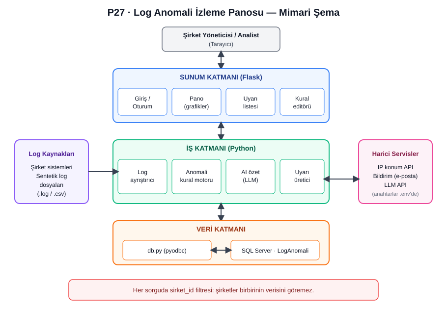
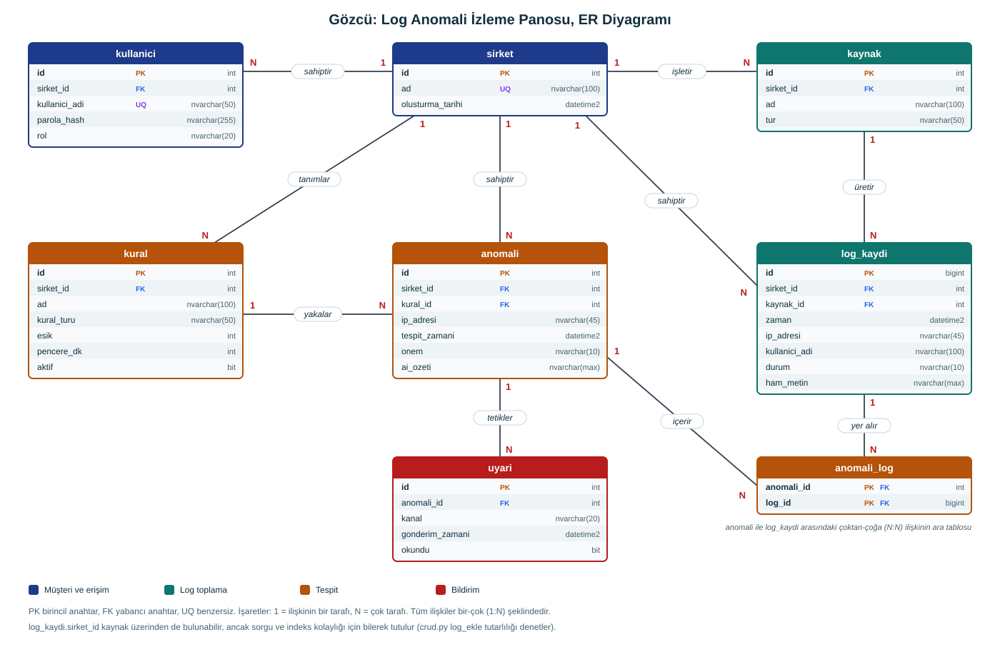

# Gözcü: Günlük (Log) Anomali İzleme Panosu

Şirketlerin sistemlerine yapılan giriş denemelerini (log kayıtlarını) analiz edip
**şüpheli, hatalı ve alışılmadık girişleri** yakalayan, bunları bir pano üzerinden
gösteren ve uyarı üreten çok şirketli bir web uygulamasıdır.

> **Ders:** Bilgisayar Uygulamaları I (Proje Tabanlı Ders)
> **Proje:** P27, Günlük (Log) Anomali İzleme Panosu
> **Geliştirici:** Muhammed Berkin Tanas
> **Durum:** Geliştirme aşamasında. Şu an **Hafta 3** çalışmaları tamamlanmış, Hafta 4 başlamak üzere.

---

## 1. Proje amacı

Bir şirketin sunucu, VPN veya uygulamalarına her gün yüzlerce giriş denemesi yapılır.
Bunların arasında saldırı belirtisi olan davranışları elle ayıklamak zordur.
Gözcü bu logları toplar, belirlenen kurallara göre inceler ve şüpheli durumları
şirket yöneticisine tek ekranda gösterir.

**Temel fikir:** Her şirket kendi hesabıyla giriş yapar ve **yalnızca kendi şirketinin**
giriş loglarını görür.

## 2. Planlanan özellikler

| Özellik | Açıklama |
|---|---|
| Çok şirketli yapı | Her şirketin verisi ayrıdır, şirketler birbirinin verisini göremez |
| Log içe aktarma ve ayrıştırma | Log dosyaları okunur, alanlara ayrılır ve veritabanına kaydedilir |
| Anomali kuralları | Şüpheli davranışları yakalayan kural motoru |
| Pano | Saatlik giriş grafiği, uyarı listesi, son giriş kayıtları |
| Uyarılar | Kurala takılan olaylar için önem dereceli uyarı |
| Kural editörü | Şirket yöneticisinin eşik değerlerini ayarlaması |
| Rol tabanlı erişim | Yönetici ve analist rolleri |
| Yapay zekâ özeti | Anomalilerin kısa ve anlaşılır özeti |
| Rapor | Dışa aktarılabilir özet rapor |

### Anomali kuralları (başlangıç seti)

1. **Çok sayıda başarısız giriş:** Aynı IP'den kısa sürede belirli sayıda hatalı giriş.
2. **Çok sayıda kullanıcı adı denemesi:** Aynı IP'nin birçok farklı kullanıcıyı denemesi.
3. **Başarısızlıktan sonra başarılı giriş:** Art arda hatadan sonra gelen başarılı giriş.
4. **Mesai dışı giriş:** Alışılmadık saatlerde yapılan giriş.

## 3. Mimari

Uygulama üç katmanlı olarak tasarlanmıştır:

- **Sunum katmanı** (`app/presentation`): Web sayfaları, giriş ekranı, pano.
- **İş katmanı** (`app/business`): Log ayrıştırma, anomali kural motoru, uyarı üretimi.
- **Veri katmanı** (`app/data`): Veritabanı bağlantısı ve sorgular.



Katmanları ayırmak her parçanın tek bir işi yapmasını sağlar. Örneğin veritabanı
değişirse yalnızca veri katmanı etkilenir.

## 4. Veritabanı

Veritabanı **Microsoft SQL Server** üzerinde `LogAnomali` adıyla kurulur.
Toplam 8 tablo vardır:

| Tablo | Açıklama |
|---|---|
| `sirket` | Sisteme kayıtlı şirketler |
| `kullanici` | Panele giren kişiler (bir şirkete bağlı, rolü vardır) |
| `kaynak` | Şirketin log gönderen sistemi (web sunucusu, VPN vb.) |
| `log_kaydi` | Tek bir giriş denemesi (zaman, IP, kullanıcı, başarılı/başarısız) |
| `kural` | Şirkete özel anomali kuralları ve eşikleri |
| `anomali` | Bir kuralın yakaladığı şüpheli durum |
| `anomali_log` | Anomali ile log kaydı arasındaki çoktan-çoğa ilişki (ara tablo) |
| `uyari` | Gösterilen veya gönderilen bildirim |

**İlişkiler:** Bir şirketin çok kullanıcısı, kaynağı, kuralı ve logu vardır (1-N).
Bir anomali birden çok log kaydından oluşabilir ve bir log birden çok anomaliye
ait olabilir (N-N), bu yüzden `anomali_log` ara tablosu kullanılmıştır.

**Veri izolasyonu:** `log_kaydi`, `kural` ve `anomali` tabloları doğrudan `sirket_id`
taşır. Her sorguda bu alana göre filtre uygulanır.



## 5. Klasör yapısı

```
.
├── app/
│   ├── presentation/     # Sunum katmanı (web sayfaları)
│   ├── business/         # İş katmanı (ayrıştırma, kurallar)
│   └── data/             # Veri katmanı (veritabanı erişimi)
├── docs/
│   ├── er_diyagrami.svg        # ER diyagramı
│   ├── mimari_sema.svg         # Mimari şema
│   ├── pano_demo.html          # Prototip ekran (sentetik veri)
│   └── ai_kullanim_gunlugu.md  # Yapay zekâ kullanım günlüğü
├── sql/
│   └── 01_tablolar.sql         # Tabloları oluşturan script
├── tests/                      # Testler (ilerleyen haftalarda)
├── .env.example                # Ortam değişkenleri şablonu
├── .gitignore
├── requirements.txt
└── README.md
```

## 6. Kullanılan teknolojiler

- **Python 3.13**: uygulama dili
- **Flask**: web çerçevesi
- **Microsoft SQL Server (Express)**: veritabanı
- **pyodbc**: Python ile SQL Server bağlantısı
- **python-dotenv**: ayarları `.env` dosyasından okuma
- **pytest**: testler
- **HTML, CSS, JavaScript**: arayüz

## 7. Kurulum

### Gereksinimler
- Python 3.11 veya üzeri
- SQL Server 2022 Express ve SQL Server Management Studio (SSMS)
- ODBC Driver 18 for SQL Server
- Git

### Adımlar

**1. Depoyu indirin**
```bash
git clone https://github.com/mamimontanas/log-anomali-panosu.git
cd log-anomali-panosu
```

**2. Sanal ortam oluşturun ve paketleri kurun**
```bash
python -m venv venv
venv\Scripts\activate
pip install -r requirements.txt
```

**3. Veritabanını oluşturun**

SSMS'te yeni bir sorgu penceresi açıp şunu çalıştırın:
```sql
CREATE DATABASE LogAnomali;
```
Ardından `sql/01_tablolar.sql` dosyasını SSMS'te açıp çalıştırın. Sonunda 8 tablo
listelenmelidir.

**4. Ayar dosyasını hazırlayın**

`.env.example` dosyasını `.env` adıyla kopyalayın ve kendi bilgisayarınıza göre düzenleyin:
```
DB_SERVER=localhost\SQLEXPRESS
DB_NAME=LogAnomali
DB_DRIVER=ODBC Driver 18 for SQL Server
DB_TRUSTED=yes
```
`.env` dosyası GitHub'a yüklenmez, parola ve bağlantı bilgisi içerebilir.

**5. Bağlantıyı test edin** *(Hafta 4'te eklenecek)*
```bash
python -m app.data.db
```

## 8. Prototip ekran

`docs/pano_demo.html` dosyasını tarayıcıda açarak arayüz tasarımını görebilirsiniz.
Bu ekran **tasarım prototipidir**: veriler koda gömülü sentetik örneklerdir ve henüz
veritabanına bağlı değildir. İki örnek şirketle çok şirketli yapıyı gösterir.

## 9. Geliştirme planı

| Hafta | Konu | Durum |
|---|---|---|
| 3 | Kurulum, mimari, ER diyagramı | Tamamlandı |
| 4 | Veritabanı ve veri erişim katmanı (CRUD, sentetik veri) | Sırada |
| 5 | Kullanıcı yönetimi ve kimlik doğrulama | Planlandı |
| 6 | Log içe aktarma ve ayrıştırma | Planlandı |
| 7 | Anomali tespit kuralları | Planlandı |
| 8 | Vize: ara sürüm ve demo | Planlandı |
| 9 | Harici API entegrasyonu | Planlandı |
| 10 | Yapay zekâ bileşeni | Planlandı |
| 11 | Kural editörü | Planlandı |
| 12 | Pano ve rapor | Planlandı |
| 13 | Test ve hata ayıklama | Planlandı |
| 14 | Dokümantasyon ve dağıtım hazırlığı | Planlandı |
| 15 | Final entegrasyon ve sunum | Planlandı |

## 10. Güvenlik ve veri gizliliği

- **Gerçek kişisel veri kullanılmaz.** Tüm log verileri sentetik olarak üretilir (KVKK uyumu).
- Parolalar düz metin saklanmaz, hash'lenir (Hafta 5).
- Gizli bilgiler (`.env`, API anahtarları) depoya yüklenmez.
- Şirketler arası veri izolasyonu her sorguda `sirket_id` filtresiyle sağlanır.

## 11. Yapay zekâ kullanım beyanı

Bu projede yapay zekâ araçlarından yararlanılmıştır. Her kullanımın tarihi, aracı,
istemi, çıktısı ve geliştiricinin kendi katkısı
[`docs/ai_kullanim_gunlugu.md`](docs/ai_kullanim_gunlugu.md) dosyasında kayıtlıdır.
Projedeki kodlar geliştirici tarafından incelenmiş, çalıştırılmış ve anlaşılmıştır.

## 12. Lisans ve kullanım

Bu proje ders kapsamında eğitim amaçlı geliştirilmektedir.
